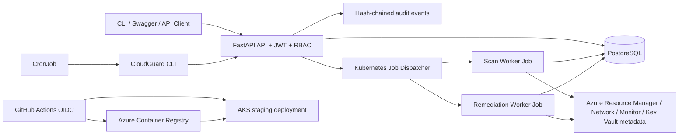

# CloudGuard Architecture

## Runtime modes

- `AZURE_MODE=mock`: bundled JSON fixtures; no Azure resources are changed.
- `AZURE_MODE=azure`: `DefaultAzureCredential` or optional service-principal credentials are used to read Azure resources. Live tag remediation and exact approved NSG-rule removal are supported.
- `EXECUTION_MODE=inline`: local development executes scans/remediation in the API process.
- `EXECUTION_MODE=kubernetes`: the API creates short-lived Kubernetes Jobs for scans and remediation; the scheduled CronJob calls the API through the CLI.

## Safety boundaries

High/Critical findings are never executed without a Security Officer/Admin decision. NSG remediation re-fetches the NSG and verifies the exact named rule is still an inbound allow rule with a broad source and administrative port before removing it. Disk deletion, VM shutdown, and secret rotation are not automated.
